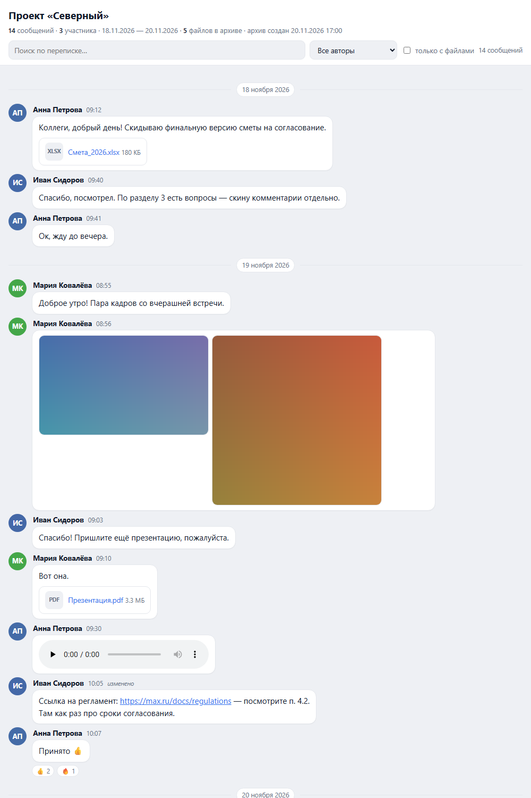

# MAX Chat Archiver

Расширение для Firefox, которое сохраняет переписку чата в `web.max.ru` целиком — с начала доступной истории и со всеми вложениями — в один ZIP-архив с `chat.html` в виде обычного чата.



## Как это работает

У MAX нет публичного API для пользовательских чатов. Веб-версия общается с сервером по **бинарному WebSocket** (protobuf, `wss://api.oneme.ru/websocket`), поэтому перехват JSON-запросов сам по себе ничего не даёт. Расширение собирает данные из двух независимых источников и склеивает их:

1. **Сеть** — `page-hook.js` патчит `fetch`, `XMLHttpRequest` и `WebSocket` и копирует всё, что удаётся прочитать как JSON, плюс образцы бинарных кадров для диагностики. Если у MAX остались HTTP-эндпоинты (вложения, профили), они попадут сюда.
2. **Экран** — `dom.js` разбирает отрисованный список сообщений: находит блоки с временем `ЧЧ:ММ`, определяет автора, направление (своё/чужое по геометрии), собирает текст, картинки, видео, аудио и названия файлов. Работает без знания протокола.
3. `content.js` прокручивает историю вверх, на каждом шаге досканирует экран, скачивает вложения и собирает ZIP.

Сообщения из двух источников объединяются: если сеть дала точные данные, они в приоритете, а то, чего в сети не было, добавляется с экрана.

## Установка

### Вариант 1. Как обычное дополнение — постоянно

Обычный Firefox ставит на постоянной основе **только подписанные** дополнения. Подпись бесплатная, делается один раз:

1. Зарегистрируйтесь на [addons.mozilla.org](https://addons.mozilla.org/developers/) и получите ключи API: [AMO → API Keys](https://addons.mozilla.org/developers/addon/api/key/). Нужны `JWT issuer` и `JWT secret`.
2. Соберите архив: `npm run build` → появится `dist/max-chat-archiver-1.2.0.xpi` и чистая папка `dist/package/` для подписи.
3. Подпишите в режиме self-distribution (расширение не публикуется в каталоге, только подписывается):

   ```
   npx web-ext@8 sign --channel=unlisted --source-dir dist/package --artifacts-dir dist/signed \
     --api-key=ВАШ_JWT_ISSUER --api-secret=ВАШ_JWT_SECRET
   ```

4. В `dist/signed/` появится файл вида `max_chat_archiver-1.2.0-an+fx.xpi`.
5. В Firefox: `about:addons` → шестерёнка справа сверху → **«Установить дополнение из файла…»** → выберите этот `.xpi`. После перезапуска браузера оно остаётся на месте.

Обновления — вручную: подписать новую версию тем же ключом и поставить поверх (ID в `manifest.json` должен оставаться тем же).

**Без AMO** подпись можно отключить только в Firefox Developer Edition, Nightly или ESR: `about:config` → `xpinstall.signatures.required = false`, затем установить `.xpi` из файла. В обычном Firefox этот переключатель игнорируется.

### Вариант 2. Временно, без подписи

1. Скачайте `max-chat-archiver.xpi` (или возьмите папку с исходниками).
2. В Firefox откройте `about:debugging#/runtime/this-firefox`.
3. Нажмите **«Загрузить временное дополнение…»** и выберите `manifest.json` из папки расширения (или сам `.xpi`).
4. Расширение появится в списке. Загруженное таким способом живёт до перезапуска Firefox — после перезапуска повторите шаг 3.

Требуется Firefox 142 или новее (нужно свойство `data_collection_permissions` в манифесте) и только десктоп.

## Использование

1. После установки/обновления **перезагрузите вкладку** `web.max.ru` — перехватчик должен встать раньше приложения MAX. Потом войдите по номеру.
2. Откройте нужный чат.
3. Нажмите иконку расширения на панели инструментов — появится панель в правом нижнем углу. В статусе два счётчика: `Сеть` и `с экрана`.
4. **«1. Вся история»** — расширение само прокручивает чат вверх до начала и на каждом шаге досканирует экран. Счётчик «с экрана» должен расти.
5. **«2. Собрать архив»** — скачивает вложения и отдаёт ZIP в «Загрузки».
6. Распакуйте ZIP целиком и откройте `chat.html`.

Опции: скачивать ли файлы, максимальный размер одного файла, общий лимит архива (по умолчанию 800 МБ).

## Что внутри архива

```
chat.html          — переписка в виде чата: пузыри, авторы, время, разделители по дням,
                     поиск по тексту, фильтр по автору и «только с файлами»
files/             — вложения (фото, видео, голосовые, документы)
data/messages.json — те же сообщения машинночитаемо
data/network-samples.json — образцы перехваченных ответов и кадров WS (диагностика)
README.txt         — сводка: сколько сообщений, период, что не скачалось
```

## Ограничения — честно

- **Сбор с экрана — это сбор с экрана.** Точные ID сообщений, реакции, ответы-цитаты и автор в групповых чатах могут теряться: их нет в отрисованном DOM.
- **Документы (PDF, DOCX, XLSX) скачать нельзя**, если MAX не показывает на них прямую ссылку: сохраняется карточка с именем файла и пометкой «в архиве только название». Фото и видео скачиваются (в том числе через `blob:`-ссылки из контекста страницы).
- **История ограничена тем, что отдаёт сервер.** Если MAX не показывает сообщения до вашего вступления в группу, расширение их не получит.
- **Нужна прокрутка.** Кнопка «1. Вся история» как раз и загружает всё в страницу.
- **Тексты упрощены:** форматирование, упоминания и кастомные эмодзи сводятся к тексту.
- **Расширение не подписано** — Firefox разрешает такое только как временное дополнение.
- Пункт 4.3.7 пользовательского соглашения MAX запрещает автоматизированный сбор информации без согласия компании. В архиве будут персональные данные собеседников — храните его соответственно.

## Оговорки

- Проект не связан с MAX, VK или ООО «МАХ»; слово в названии описывает только совместимость.
- Пункт 4.3.7 пользовательского соглашения MAX запрещает автоматизированный сбор информации без согласия компании. Расширение работает по действию пользователя с уже открытой страницей, но ответственность за использование лежит на пользователе.
- В архиве оказываются персональные данные собеседников. Храните и передавайте его так же, как хранили бы распечатку переписки.

## Если не работает

| Симптом | Что делать |
|---|---|
| Панель не появляется | Проверьте, что вы на `web.max.ru` (не `max.ru`) и что дополнение загружено в `about:debugging` |
| «с экрана: 0» после прокрутки | Нажмите «Диагностика» и пришлите JSON: в нём есть срез DOM (`domSample`), список ресурсов и кадры WebSocket. По нему видно, как размечать сообщения |
| Счётчик растёт, но сообщений мало | Прокрутите чат вручную до нужного места и нажмите «1. Вся история» ещё раз — сканирование добавит пропущенное |
| Файлы не скачиваются | Проверьте лимиты в панели; документы без прямой ссылки не скачиваются в принципе |

## Разработка

```
npm install          # jsdom для тестов DOM
npm test             # извлечение из JSON, разбор DOM, рендер, ZIP
npm run lint         # проверка манифеста через web-ext
npm run build        # собрать dist/max-chat-archiver-<версия>.xpi
npm run demo         # демо-архив в dist/demo/ + dist/demo-archive.zip
npm run e2e          # полный прогон в headless Firefox на локальной копии чата
```

- `common.js` — ZIP (метод STORE, без зависимостей) и рендер HTML.
- `extract.js` — разбор JSON-ответов API (на случай, если они есть).
- `dom.js` — сбор с экрана: блоки сообщений, время, направление, вложения.
  Точный разбор идёт по реальной разметке MAX (`.capsuleSeparator` → дата, `.block` → сообщение, `.messageWrapper--isOut` → своё, `.bubbleContent span.text[data-message-markup]` → текст, `.meta--text` → время, `.reaction` → реакции), эвристика остаётся запасным вариантом.
- `content.js` — панель, автопрокрутка, объединение источников, скачивание, сборка.

E2E-прогон поднимает локальную страницу, размеченную как чат MAX (пузыри, свои/чужие, разделители дней, картинки, карточки файлов), которая, как и оригинал, подгружает историю порциями при прокрутке. Расширение ставится в headless Firefox через `web-ext`, само прокручивает и собирает архив. Проверка: 40 из 40 сообщений, 8 картинок в `files/`, 20 своих сообщений выровнены вправо.

## Репозиторий

```
git init
git add .
git commit -m "MAX Chat Archiver 1.2.0"
git branch -M main
git remote add origin git@github.com:<ваш-аккаунт>/max-chat-archiver.git
git push -u origin main
```

Что уже лежит в репозитории: исходники, тесты (юнит + E2E), `package.json` со скриптами, CI для GitHub Actions (`.github/workflows/ci.yml`: тесты → сборка → `web-ext lint` → артефакт `.xpi`), MIT-лицензия и `.gitignore`.

В `.gitignore` намеренно нет `dist/`-артефактов в коммитах — собранный `.xpi` лучше выкладывать в GitHub Releases:

```
gh release create v1.2.0 dist/max-chat-archiver-1.2.0.xpi --title "1.2.0" --notes "Первый публичный релиз"
```
